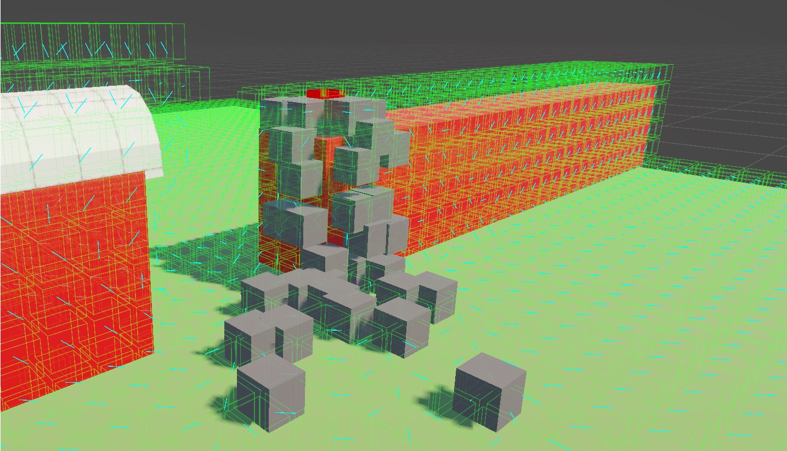

# ECS Flow Field System (Unity 6.4)

A high-performance **Flow Field pathfinding system** built for **Unity ECS 6.4.0 (Unity 6.4)** using Dijkstra's algorithm. 

It dynamically evaluates the entire terrain and handles crowd congestion around the destination by increasing cell traversal costs. The flow field automatically recalculates every **0.3 seconds** to adapt to moving units and changing environments.

---

## ✨ Features
* **Dijkstra-based Pathfinding:** Efficient multi-agent navigation across large grids.
* **Dynamic Crowd Avoidance:** Increases cell cost around the target point to prevent unit clumping and bottlenecks.
* **Fast Recalculation:** Updates every `0.3s` for responsive group movement.
* **Cross-Platform Input:** `FlowFieldDestinationSetter` supports both mouse clicks and touch/touchpad inputs out of the box.
* **Visual Debugging:** Built-in `FlowFieldDebugVisualizer` renders voxel flow directions directly in the scene.

---

## 📋 Requirements
* **Unity:** 6.4 or higher
* **Entities (ECS):** 6.4.0
* **Unity Physics** (for ECS world collision/baking)

---

## 🚀 Setup & Usage

### 1. Scene & Physics Setup
1. In your main **MonoBehaviour scene**, add your floor and wall geometry.
2. Assign these objects to a dedicated **Obstacle layer**.
3. Create duplicates of these floor and wall objects inside your **SubScene**. This ensures physics works properly within the ECS world, as the flow field baking relies on these entities.

### 2. Flow Field Configuration
1. Create an empty GameObject in your scene and attach the `FlowFieldAuthoring` component.
2. In the `FlowFieldAuthoring` inspector:
   * Select your **Obstacle layer**.
   * Specify the **grid size** for the Flow Field recalculation.
3. Set the **Transform Position** of the `FlowFieldAuthoring` object to `(-0.5, -0.5, -0.5)`. 
   > *Note: Since the default voxel size is `Vector3.one`, this offset is required to properly align voxel centers with the grid.*

### 3. Setting Destinations & Debugging
* **Destination Input:** Add `FlowFieldDestinationSetter` to handle target selection. It works seamlessly with both **mouse clicks** and **touchpads/touchscreens**.
* **Debug Visualization:** Enable or attach `FlowFieldDebugVisualizer` to see real-time directional vectors for every voxel cell in the grid.

---

## 📄 License
[MIT](LICENSE) *(Replace with your preferred license)*
